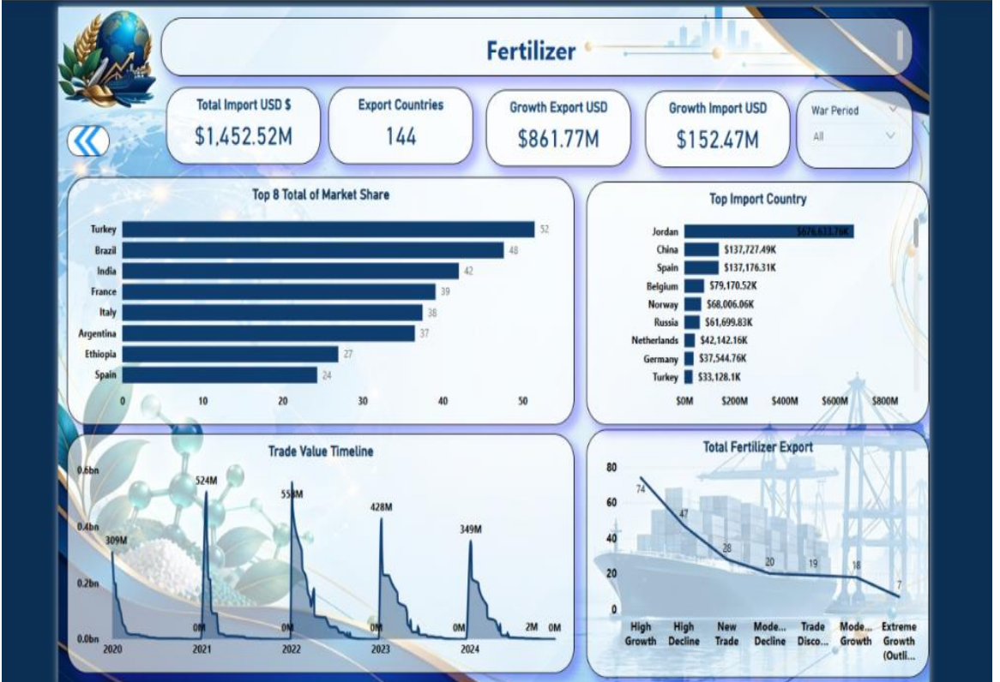

# 🌍 DUAL DEPENDENCY GAP (DDG)

### Egypt's Trade Vulnerability to Global Geopolitical Shocks

**Turning Trade Data into Strategic Insights**

---

## 📌 Project Overview

Dual Dependency Gap (DDG) is a data analytics and business intelligence project designed to assess Egypt's import dependency and trade vulnerability to global geopolitical shocks.

The project examines how concentrated import sources, global price volatility, and supply chain disruptions affect Egypt's strategic sectors, particularly following the Russia–Ukraine war.

It transforms international trade data into actionable insights through interactive Power BI dashboards, statistical analysis, and predictive modeling.

## 🖼️ Dashboard Preview

<table>
  <tr>
    <td align="center" width="50%">
      
       
      <b>📌 Overview</b>
    </td>
    <td align="center" width="50%">
      
       
      <b>🌾 Food Commodities</b>
    </td>
  </tr>
  <tr>
    <td align="center" width="50%">
      
       
      <b>🌱 Fertilizers</b>
    </td>
    <td align="center" width="50%">
      
       
      <b>🏗️ Iron & Steel</b>
    </td>
  </tr>
</table>

🔍 Click any dashboard to view it in full size.

## 🎯 Business Problem

Egypt's reliance on imported commodities from a limited number of supplier countries creates significant exposure to:

- Geopolitical conflicts and international disruptions.
- Global commodity price fluctuations.
- Supplier concentration and dependency risks.
- Supply chain instability.
- Limited visibility into vulnerable commodities and trading partners.

The project aims to support better decision-making through data-driven trade risk analysis.

## 🎯 Project Objectives

1. Analyze Egypt's import and export trends across strategic sectors.
2. Measure import dependency and supplier concentration.
3. Evaluate the impact of global geopolitical shocks.
4. Analyze commodity prices, market shares, and trade growth.
5. Identify high-risk commodities and supplier countries.
6. Develop predictive models to forecast future trade trends through 2030.
7. Deliver actionable insights through interactive dashboards.

## 📊 Data Scope & Coverage

| Metric | Coverage |
|---|---|
| Trade Records | 8,150+ |
| Countries | 144 |
| Strategic Sectors | 3 |
| Trade Data Sources | 4 datasets |

### Strategic Sectors

- 🌾 Food Grains
- 🌱 Fertilizers
- 🏗️ Iron & Steel

The analysis also incorporates country reference data and commodity classifications.

## 🛠️ Tools & Technologies

| Technology | Application |
|---|---|
| Power BI | Interactive dashboards and visualization |
| Python | Data cleaning, integration, and predictive modeling |
| Power Query | ETL and data transformation |
| Excel | Raw data handling and preparation |
| DAX | Analytical measures and KPIs |
| Star Schema | Data modeling and relationships |

## ⚙️ Methodology

### 1. Data Collection
Gathered and integrated international trade datasets covering imports, exports, commodities, and global trading partners.

### 2. Data Cleaning & Transformation
- Data standardization.
- Handling missing values.
- Merging multiple datasets.
- Data preparation and feature engineering.

### 3. Data Modeling
Developed a structured semantic model using a Star Schema approach, incorporating fact and dimension tables.

### 4. Exploratory & Statistical Analysis
- Import and export analysis.
- Commodity price and growth analysis.
- Market share analysis.
- Supplier concentration using the Herfindahl-Hirschman Index (HHI).
- Trade balance and dependency indicators.

### 5. Predictive Modeling
Evaluated datasets individually using cross-validation and selected forecasting approaches.

- Agriculture: Ridge Regression.
- Fertilizers: Naive Last Import.
- Iron & Steel: Naive Last Import.

Forecasting and trend analysis extend through 2030.

### 6. Visualization & Reporting
Developed an interactive Power BI dashboard to explore trade dependencies, sector performance, supplier relationships, and risk indicators.

## 📈 Key Results & Insights

The project dashboard highlights:

- **54,939.63M USD** in total imports across the three strategic sectors.
- **47,049.48M USD** in food grains imports.
- **1,453M USD** in fertilizer imports.
- **6,437.63M USD** in iron and steel imports.
- **38.60%** Russia and Ukraine share of imports across selected commodities.

### Key Analytical Findings

1. Significant import dependency in food grains and fertilizers.
2. Exposure to concentrated international supplier networks.
3. The importance of monitoring geopolitical and supply chain risks.
4. The value of predictive analytics for future trade planning.

*Figures are based on the project dashboard and its selected analysis scope.*

## 📊 Project Deliverables

- Interactive Power BI Dashboard.
- Trade Dependency Analysis.
- Supplier Concentration & Risk Assessment.
- Predictive Forecasting Models.
- Web-Based Trade Analysis Platform.
- Strategic Insights and Recommendations.

## 👩‍💻 My Contribution

As a member of the project team, my responsibilities included:

- Designing the project poster and visual identity.
- Developing and maintaining the project website.
- Integrating project content and visual assets.
- Improving the presentation and organization of project outputs.

The project was developed collaboratively, with team members contributing to planning, code reviews, testing, and final integration.

## 💡 Business Value

This project demonstrates how data analytics and business intelligence can transform complex international trade data into meaningful insights.

It provides a foundation for:

- More informed import planning.
- Better supplier diversification strategies.
- Early identification of trade vulnerabilities.
- Improved supply chain resilience.
- Data-driven strategic decision-making.

---

### Turning Data into Decisions.
### Building a More Resilient Egypt. 🇪🇬

**Dual Dependency Gap | Capstone Project 2026**
